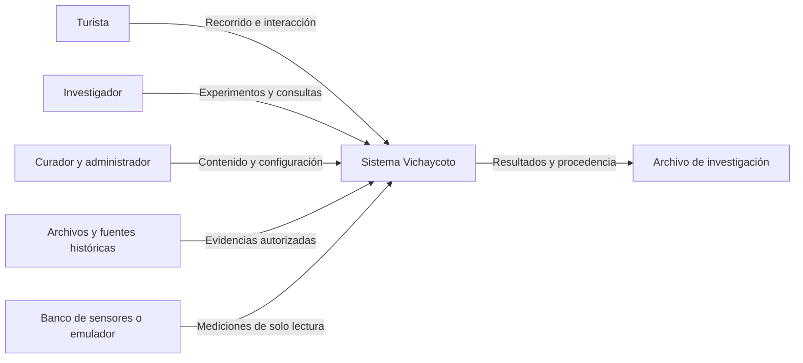
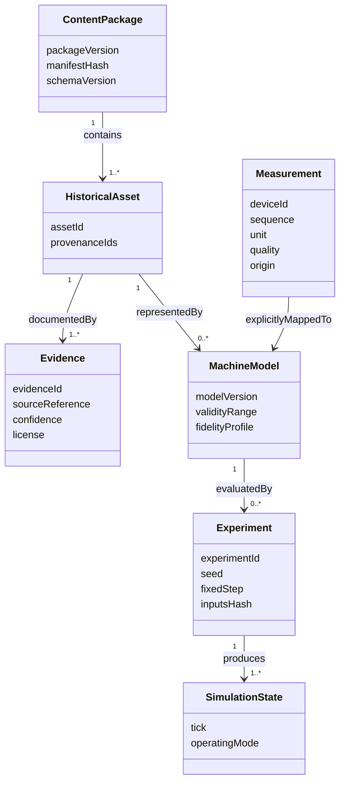
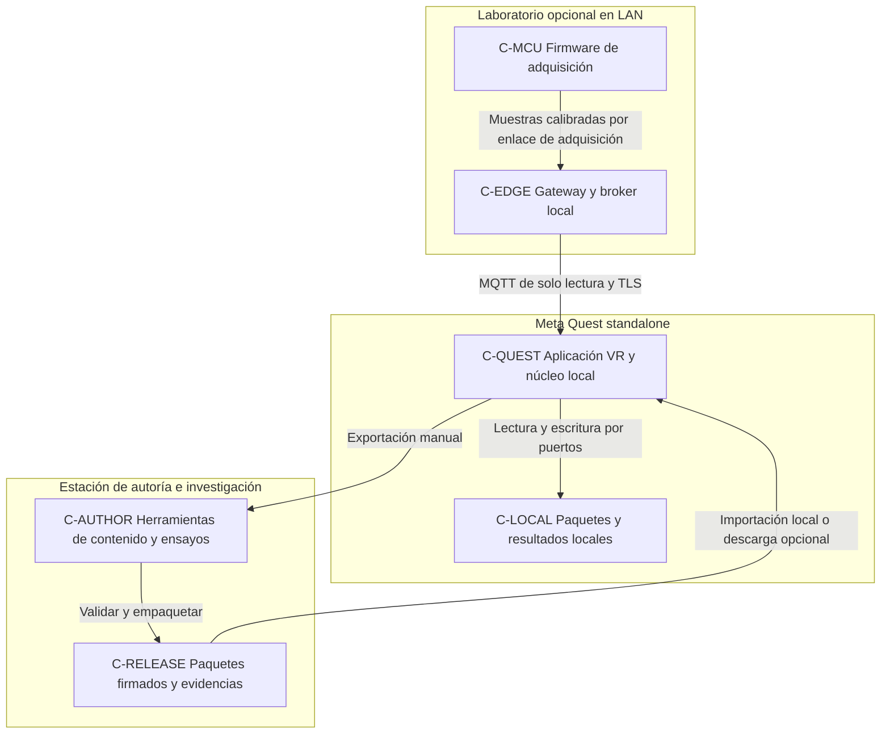
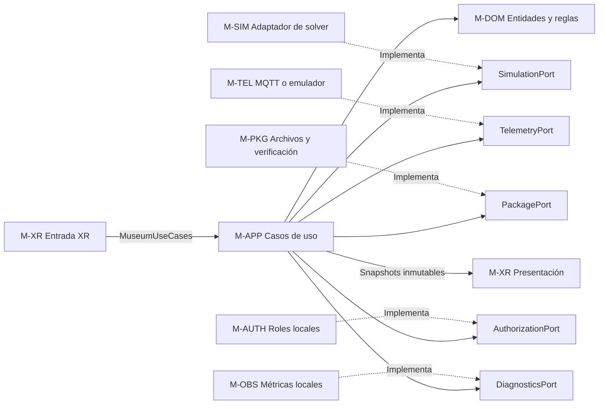
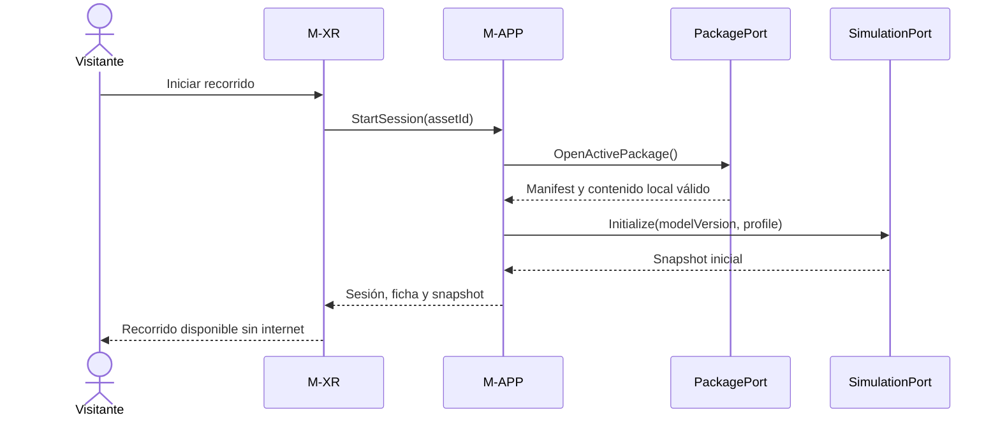
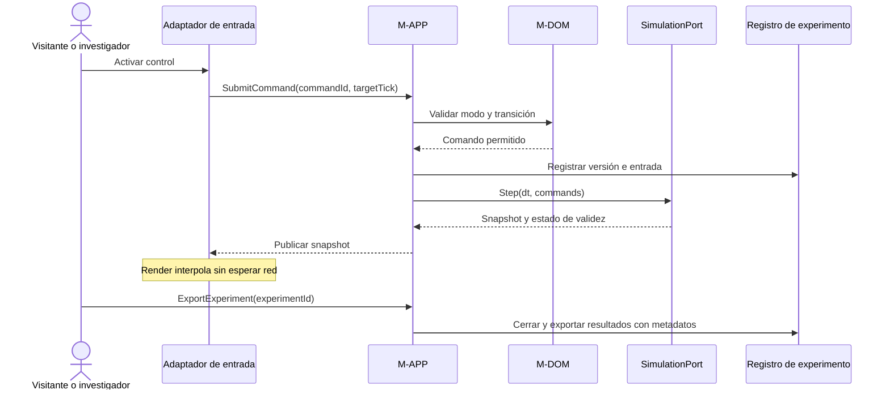
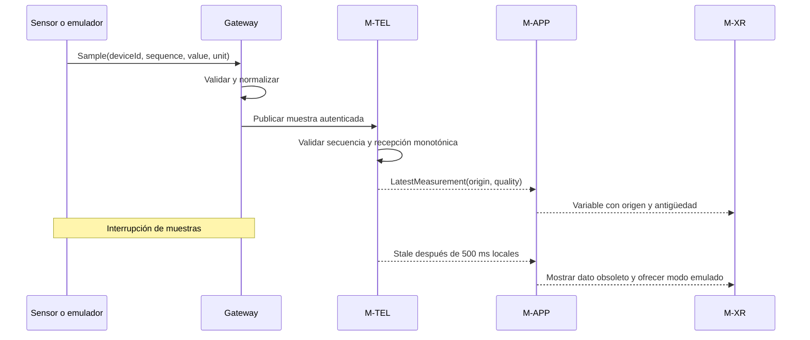
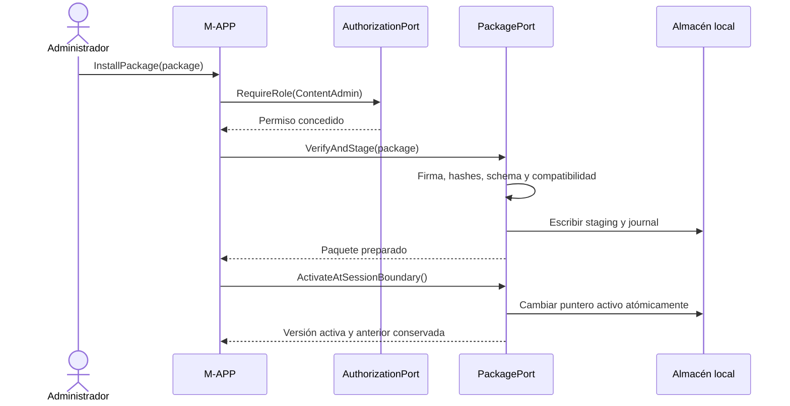
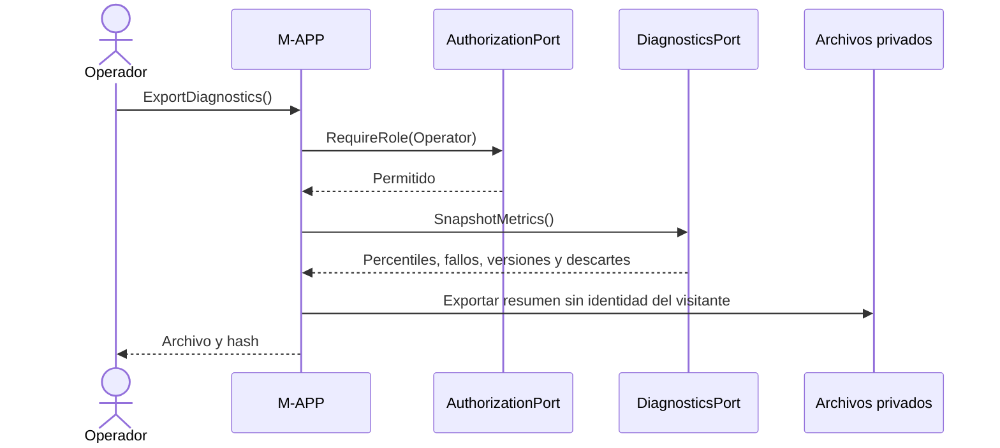

# Laboratorio Histórico Vichaycoto: Gemelo Digital y Museo Interactivo en VR — Architecture Document

## 1. Introduction

Arquitectura propuesta mediante ADD para preservar patrimonio, explorar instalaciones en Meta Quest y reproducir procesos históricos con simulación y telemetría opcional. Destinatarios: curaduría, investigadores, desarrolladores XR, ingeniería mecatrónica y operación del museo. Fecha de referencia: 2026-10-12. Estado: diseño documental, pendiente de revisión e implementación.

Las fuentes locales son la guía ADD y el ejemplo HPS. Se conserva el orden de vistas de HPS; decisiones pasan a sección 9 por exigencia de la guía ADD y eventos a sección 10. Los pasos 1–7 están documentados en drivers y seis iteraciones. No se asume código de producto existente, infraestructura instalada, máquinas inventariadas ni resultados medidos. Toda cifra es una meta propuesta.

Se propone un monolito modular hexagonal en el visor, herramientas de autoría en estación de trabajo y gateway de adquisición opcional en LAN. No se exige nube para visita, simulación, administración local ni consulta de contenidos instalados. La sincronización consiste inicialmente en importar paquetes y exportar experimentos, no en un backend de ejecución permanente.

## 2. Context Diagram



Límite: no controlar maquinaria patrimonial ni actuadores físicos desde VR. Un banco instrumentado es distinto de una reconstrucción histórica; la interfaz siempre muestra el origen. Internet solo facilita distribución opcional de artefactos. Multijugador, control industrial, reconstrucción de toda la fábrica y certificación metrológica no forman parte de la primera entrega.

## 3. Architectural Drivers

### User Stories

VIC-1 explorar offline; VIC-2 operar maquinaria virtual; VIC-3 reproducir y exportar experimentos; VIC-4 adquirir o emular telemetría; VIC-5 curar e instalar patrimonio; VIC-6 administrar y diagnosticar. Descripciones y prioridades canónicas: [ArchitecturalDrivers.md](../ArchitecturalDrivers.md).

### Quality Attribute Scenarios

QA-1 rendimiento VR; QA-2 fidelidad; QA-3 offline; QA-4 portabilidad; QA-5 integridad; QA-6 telemetría; QA-7 aislamiento y seguridad; QA-8 reproducibilidad; QA-9 observabilidad y despliegue; QA-10 confort. Los seis campos de escenario y umbrales están en el documento de drivers; la sección 11 asigna evidencias.

### Constraints

CON-1 Meta Quest offline; CON-2 integración hexagonal; CON-3 Markdown y destino GitHub indicado; CON-4 observación física sin actuación; CON-5 perfil provisional Quest 3/72 Hz; CON-6 banco provisional de ocho canales a 50 Hz. CON-4 a CON-6 son decisiones o supuestos por validar.

### Architectural Concerns

CRN-1 límites del sistema; CRN-2 evidencia y clasificación de fidelidad; CRN-3 carga móvil; CRN-4 versionado; CRN-5 entrega verificable. Las seis iteraciones y sus drivers están en [IterationPlan.md](IterationPlan.md).

## 4. Domain Model

### Class Diagram



### Domain Model Description

HistoricalAsset representa una instalación o pieza con identificador estable; no presupone inventario disponible. Evidence registra fuente, autoría, permisos, fecha y clasificación: documentado, inferido o hipotético. MachineModel define geometría lógica, parámetros, ecuaciones, unidades SI, límites y reglas operativas. El activo visual optimizado es una representación derivada, no la fuente del modelo físico.

Experiment congela versiones, entradas, semilla, solver, plataforma y paso. SimulationState contiene variables y estado operativo (Stopped, Starting, Running, Paused, Fault). Las transiciones inválidas se rechazan y los límites de parámetros se comprueban antes de ejecutar. Un proceso eléctrico se representa inicialmente por estados y variables parametrizadas; transitorios complejos requieren modelo adicional validado.

### Relationships

Cada modelo enlaza sus fuentes y rango validado. Una Measurement solo afecta un modelo mediante mapeo explícito de dispositivo, variable, unidad, calibración y modo. El modo es Simulated, Emulated o Measured; mezclar fuentes para una misma variable está prohibido salvo política de fusión aprobada y documentada. El cambio de modo crea un evento y reinicia la ventana de comparación. Ausencia de medición nunca se muestra como cero.

## 5. Container Diagram

Los contenedores representan unidades de ejecución o almacenamiento, no módulos que deban desplegarse como servicios separados.



### Container Responsibilities

| Contenedor | Responsabilidad | Tecnología propuesta | Fallo y recuperación |
|---|---|---|---|
| C-QUEST | Interacción, simulación museo, contenido y métricas | Unity/C#, adaptador OpenXR, build Android; versiones por confirmar | Pausa segura, reinicio local y paquete previo |
| C-LOCAL | Paquete activo/anterior, sesiones y journal | Archivos privados y escritura temporal atómica | Cuotas, validación al arranque y recuperación de journal |
| C-AUTHOR | Modelado, curaduría, validación y exportación | Blender como herramienta propuesta; runner C# headless para solver | Fuentes versionadas; repetir empaquetado |
| C-RELEASE | Artefactos inmutables y manifiestos | Directorio local; servidor de archivos opcional | Visor no depende de su disponibilidad |
| C-EDGE | Normalizar unidades, validar muestras y servir LAN | Servicio portable en estación o SBC, broker MQTT 5 | Heartbeat y modo desconectado; VR sigue local |
| C-MCU | Muestrear, marcar secuencia y detectar fallo | MCU y sensores por seleccionar; firmware modular | Watchdog, buffers acotados e indicador de fallo |

Distribución: desarrollar en escritorio, integrar con emulador, aceptar con Quest y banco, operar en exposición offline. Configuración específica por entorno se inyecta fuera del núcleo. No se impone Kubernetes ni servicios cloud al museo.

## 6. Component Diagrams

### 6.1 Aplicación hexagonal



Las flechas sólidas son dependencias; las discontinuas implementan contratos. Los puertos pertenecen al núcleo de aplicación y usan DTO neutrales. M-DOM no importa Unity, OpenXR, MQTT, sistema de archivos ni reloj del SO. M-APP depende de dominio y abstracciones; adaptadores dependen del núcleo. CompositionRoot conecta implementaciones al arrancar. Pruebas de dependencias impiden referencias inversas.

### 6.2 Component Responsibilities

| Módulo | Responsabilidades | Puertos y datos | Responsable por rol |
|---|---|---|---|
| M-DOM | Evidencias, parámetros, estados y reglas históricas | Tipos SI y entidades sin SDK | Simulación y curaduría |
| M-APP | Orquestar sesión, modos, comandos y experimentos | MuseumUseCases, ResearchUseCases; puertos de salida | Arquitectura |
| M-SIM | Evolucionar modelos, validar rangos y producir snapshots | SimulationPort | Simulación |
| M-XR | Capturar entrada semántica, renderizar y aplicar confort | MuseumUseCases y SnapshotStream | XR |
| M-TEL | Convertir y validar muestras, distinguir origen y calidad | TelemetryPort | Mecatrónica |
| M-PKG | Verificar manifiesto, firma, compatibilidad e instalación | PackagePort | Contenido y operación |
| M-AUTH | Verificar roles locales y acceso a operaciones | AuthorizationPort | Arquitectura y operación |
| M-OBS | Agregar métricas y exportar diagnóstico | DiagnosticsPort | QA y operación |

### 6.3 Simulación y ejecución temporal

Modelo museo: paso fijo inicial 1/100 s, escogido como configuración propuesta y sujeto a estabilidad numérica por modelo. Renderizado a 72 Hz consume el snapshot disponible e interpola estados visuales; la pose de cabeza usa el runtime XR directamente y no espera a la física. Limitar a tres pasos de recuperación por ciclo. Si persiste retraso, pausar el experimento y marcar discontinuidad; no avanzar el tiempo físico descartando pasos silenciosamente.

Perfil investigación: solver y paso configurables dentro del rango validado, ejecución headless con entradas registradas. No depende del ritmo de render. Reproducibilidad bit a bit entre plataformas no se promete para física de punto flotante ni para el motor; las tolerancias se fijan por modelo. Un solver del motor puede implementar SimulationPort, pero necesita validar su propia estabilidad y reproducibilidad.

Presupuesto inicial QA-1: CPU total 13,89 ms, repartido en 2 ms para planificación/simulación, 6 ms para preparación de escena y 5,89 ms para otras tareas y margen. GPU total independiente <= 13,89 ms. No se suman CPU y GPU como si fueran fases seriales. Las cuotas se ajustan con mediciones; LOD, culling, luces precalculadas y reducción de resolución visual se aplican antes de comprometer el modelo validado.

Los DTO no contienen objetos del motor; transformaciones del motor se aplican en su hilo permitido. I/O, compresión y parsing salen del hilo de presentación. Un snapshot puede intercambiarse con doble buffer. La sesión se congela en pérdida de tracking, suspensión del visor o error de modelo, sin intentar recuperar tiempo real al reanudar.

### 6.4 Firmware y gateway

Firmware propuesto: DriverSensor → AcquisitionTask → Calibration → BoundedBuffer → TransportAdapter. Watchdog y estado de alimentación son locales al MCU. Frecuencia 50 Hz por canal y ocho canales es una carga de prueba, no una propiedad confirmada de sensores concretos. Separar alimentación y señales conforme al banco seleccionado; no fijar conexión a alta tensión ni intervenir equipos patrimoniales con esta documentación.

Gateway valida rangos, identificadores, esquema y límites de mensajes, añade reloj de recepción, mantiene estado por dispositivo y aplica credenciales/ACL. El visor únicamente se suscribe a topics autorizados. La administración del gateway usa canal separado. La emulación implementa el mismo contrato y etiqueta origin=Emulated; no sustituye mediciones silenciosamente.

Cola visual: 256 muestras por canal, descarte de la más antigua al saturar y contador por canal. Para registro de investigación se usa cola independiente acotada y escritura local; si satura, se marca captura incompleta y se pausa o detiene el ensayo según política, en lugar de afirmar integridad total. El último valor válido puede mostrarse con antigüedad, nunca como medición actual tras 500 ms sin recepción.

## 7. Sequence Diagrams

### 7.1 VIC-1: iniciar visita offline



Si el paquete activo falla se abre el anterior; si ambos faltan se presenta diagnóstico local, sin prometer experiencia completa. Offline requiere aprovisionamiento previo válido.

### 7.2 VIC-2/VIC-3: operar y reproducir



Comando inválido produce InvalidTransition o OutOfRange sin modificar el estado. Repetir un experimento usa entradas y versiones fijadas; discrepancias se comparan con tolerancia registrada.

### 7.3 VIC-4/QA-6: muestra y desconexión



El usuario confirma un cambio de modo dentro de la sesión; el evento conserva el origen de las series previas. El watchdog de obsolescencia funciona localmente incluso sin mensajes del broker.

### 7.4 VIC-5/QA-5/QA-7: instalar contenido



Sin permiso se retorna Forbidden antes de escribir. Ante corte se recupera el journal y se verifica el puntero; staging nunca se considera activo. La importación no reemplaza modelos durante un experimento en curso.

### 7.5 VIC-6/QA-9: diagnóstico y entrega



## 8. Interfaces

### 8.1 Puertos de entrada y presentación

| Contrato | Operaciones | Salida | Errores y límites |
|---|---|---|---|
| MuseumUseCases | StartSession(assetId), SubmitCommand(command), Pause(reason), Reset() | SessionId, CommandResult | MissingPackage, InvalidTransition, OutOfRange; comandos sin I/O bloqueante |
| ResearchUseCases | RunExperiment(config), Replay(id), Export(id) | ExperimentId, archivo y hash | Unauthorized, UnsupportedProfile, InvalidModel; cancelación y cuota |
| SnapshotStream | ReadLatest(sessionId) | Snapshot inmutable | Si falta actualización, conservar estado con antigüedad y señal de pausa |

Command: schemaVersion, commandId UUID, sessionId, machineId, targetTick, action, parámetros SI. Validar límites y permisos en M-APP, además de restricciones físicas en M-DOM. commandId permite rechazo de duplicados dentro de una sesión; targetTick evita aplicar acciones en un tick pasado. Snapshot: tick, simulationTime, machineStates, variables SI, modelVersion, fidelityProfile, validity, sourceMode. Las operaciones son contratos internos, no endpoints HTTP obligatorios.

### 8.2 SimulationPort

Initialize(model, config), Step(dt, commands), CaptureState(), RestoreState(snapshot), ValidateModel(). Step debe terminar dentro de su presupuesto de perfil; si no puede, el planificador activa pausa y diagnóstico. Restore exige versión y perfil compatibles. Errores: UnstableModel, InvalidParameter, UnsupportedVersion. dt en segundos; ángulos en radianes, velocidad en rad/s, tensión en V y corriente en A. La geometría visual puede usar conversiones explícitas.

Experiment exportado: manifest JSON (esquema, versiones de aplicación/solver/modelo, plataforma, semilla, paso, entradas y hashes, calibración y fuente), CSV de series con unidades y calidad, fuentes históricas y licencia. No incluir pose individual de visitantes por defecto. Ficheros se escriben en temporal y se cierran antes de declarar exportación completa; captura incompleta se etiqueta.

### 8.3 TelemetryPort y transporte

Subscribe(mapping), GetLatest(variableId), GetHealth(deviceId), Disconnect(). El consumidor usa callbacks o lectura no bloqueante. Desconexión devuelve Unavailable, no excepción que detenga render. Timeout de obsolescencia se mide con reloj monotónico local.

Topic propuesto: `vichaycoto/v1/devices/{deviceId}/samples`; salud: `vichaycoto/v1/devices/{deviceId}/health`. MQTT 5 con TLS y ACL por dispositivo; QoS 0 para visualización frecuente y QoS 1 opcional para captura, siempre con deduplicación. QoS 1 permite duplicados y no garantiza integridad end to end. No confiar en mensajes retenidos como lectura actual; comprobar identidad de arranque, secuencia y timestamp. Limitar payload a 4 KiB y rangos permitidos.

```json
{
  "schemaVersion": 1,
  "deviceId": "bench-01",
  "bootId": "boot-001",
  "sequence": 42,
  "variableId": "shaft.speed",
  "value": 6.2,
  "unit": "rad/s",
  "sourceTimeUtc": "2026-10-12T15:00:00Z",
  "calibrationId": "cal-001",
  "quality": "Valid",
  "origin": "Measured"
}
```

Ejemplo de contrato, no lectura histórica real. Clave de deduplicación: deviceId+bootId+sequence+variableId. Reordenar dentro de una ventana de 100 ms o descartar muestras tardías con contador; la proyección latest nunca retrocede en secuencia del mismo arranque. El gateway añade receivedAt y el visor receivedMonotonic; sincronización de reloj y error se registran. QA-6 mide recepción gateway a visualización mediante relojes sincronizados con error cuantificado o instrumentación correlacionada; sin ese método no se declara latencia entre equipos. Stale, Invalid, Uncalibrated y Unavailable son estados distintos.

### 8.4 PackagePort y AuthorizationPort

PackagePort: VerifyAndStage(path), ListVersions(), OpenActivePackage(), Activate(version), Rollback(). Manifiesto: schemaVersion, packageVersion, compatibleAppRange, assets, fuentes, licencias, modelVersions, perfiles, hashes SHA-256 y firma sobre el manifiesto canónico. Propuesta criptográfica: Ed25519 mediante biblioteca revisada; algoritmo y librería quedan sujetos a compatibilidad de toolchain. La clave privada de publicación permanece fuera del visor y del repositorio; clave pública confiable provisionada localmente. Rotación permite transición entre claves aprobadas, nunca aceptar una clave incluida sin confianza en el paquete.

Verificar firma, hashes, tamaño máximo configurable, rutas sin traversal, ausencia de enlaces externos y compatibilidad antes de activar. Reserva de espacio: paquete activo + anterior + staging, comprobada antes de copiar. Si falta espacio, conservar activo y retornar InsufficientStorage. Activación al finalizar sesión con journal durable y cambio atómico del puntero en el mismo sistema de archivos; comprobar comportamiento real de Android durante QA-5. APK y contenido tienen ciclos independientes, pero cada combinación debe cumplir compatibleAppRange.

AuthorizationPort: Check(role, action), AuthenticateLocal(credentials), EndAdminSession(). Roles: Visitor (visita), Researcher (ensayos y exportación), ContentAdmin (paquetes), Operator (configuración y diagnóstico). M-APP verifica cada operación privilegiada; ocultar un botón no constituye autorización. Credenciales administrativas almacenadas con hashing adecuado y protección del SO, sesiones con expiración, rate limiting y registro de acciones. No se exige cuenta del visitante. La autorización local offline no garantiza revocación remota instantánea; aprovisionamiento y recuperación requieren procedimiento operativo.

### 8.5 DiagnosticsPort y contratos de pruebas

RecordMetric(name, value, tags), RecordFault(code, context), SnapshotMetrics(), Export(). Agregación por ventana, escritura fuera de render y registro circular <= 50 MB. Tags acotados: versión, perfil, dispositivo y código de error; evitar identificadores personales y alta cardinalidad. Un fallo del registro incrementa un contador y no bloquea la visita.

Tests contractuales comunes para adaptador real, emulador y fake: semántica de unidad, origen, calidad, orden y timeout. SimulationPort se prueba con modelos simples de referencia, límites y restauración. PackagePort se prueba con firmas inválidas, corrupción, schema no compatible, falta de espacio y cortes de instalación. Suite de dependencias comprueba ensamblados y referencias; QA-4 exige ejecutar un segundo adaptador funcional.

## 9. Design Decisions

Registro requerido por Step 6 de ADD. Estado: propuesto en todas las filas; aceptar una decisión no equivale a haber probado su atributo.

| Driver | Decision | Rationale | Discarded alternatives |
|---|---|---|---|
| CRN-1, CON-2, QA-4 | DA-01: Hexagonal con dominio y aplicación neutrales; adaptadores externos | Cambiar VR y sensores sin cambiar reglas | Dominio con SDK: dependencia de plataforma |
| VIC-1, QA-3, CON-1 | DA-02: Monolito modular local y contenido instalado | Visita sin red ni servicios remotos | Microservicios para cada módulo: latencia y operación adicional |
| CRN-5, QA-9 | DA-03: Autoría y reproducción en ejecutables distintos | Validación pesada fuera del visor | Editor y autoría completa dentro de Quest: carga y privilegios |
| VIC-2, QA-2, QA-8 | DA-04: Modelos parametrizados, estados y solver por puerto | Simular procesos con validez explícita | Animación puramente visual: sin contraste físico |
| VIC-3, QA-2, QA-8, CRN-2 | DA-05: Perfiles museo/investigación y evidencia versionada | Equilibrar precisión y carga, conservar hipótesis | Modelo único sin rango: fidelidad no evaluable |
| QA-1, QA-4, CON-1 | DA-06: Unity/C# y OpenXR como stack propuesto; versiones congeladas tras prototipo | Render y entrada separados del núcleo | Dependencia directa del SDK Meta en dominio; Unreal queda alternativa si prototipo justifica costo |
| QA-1, QA-10, CRN-3 | DA-07: Snapshots, interpolación, LOD y pausa segura | Acotar presentación y confort | I/O o física ilimitada en render: frames imprevisibles |
| VIC-4, QA-6, QA-8 | DA-08: Gateway LAN, MQTT y emulación por contrato | Normalizar y aislar adquisición | Acceso del visor a cada driver físico: acoplamiento |
| QA-7, CON-4, CON-6 | DA-09: Canal VR de solo lectura física y colas con cuotas | Evitar actuación y crecimiento sin límite | Control físico desde sesión turística: fuera de alcance |
| VIC-5, QA-5, QA-2 | DA-10: Paquetes firmados, staging, journal y activo/anterior | Integridad y recuperación con procedencia | Sobrescritura directa: actualización parcial |
| VIC-6, QA-7, QA-3 | DA-11: RBAC local, control en casos de uso y credenciales fuera del código | Privilegios verificables offline | Autenticación exclusivamente cloud: dependencia de internet |
| QA-8, QA-4, CRN-5 | DA-12: Pruebas headless, contratos y aceptación en dispositivos | Separar reglas de integración real | Solo tests de UI: insuficientes para física y protocolos |
| QA-9, QA-1, CRN-5 | DA-13: Métricas acotadas, artefactos identificados y promoción | Evidencia y diagnóstico con costo limitado | Logging completo por frame y recompilar por entorno |

## 10. Event Definitions

### 10.1 Eventos internos

| Evento | Productor | Consumidor | Entrega y política |
|---|---|---|---|
| SessionStarted / SessionPaused | M-APP | M-XR, M-OBS | Orden por sesión; motivos y tick |
| CommandAccepted / CommandRejected | M-APP | Registro de experimento, M-XR | Identificación por commandId; persistir si ensayo |
| SimulationSnapshot | M-SIM | M-XR | Efímero, latest wins; no escribir cada frame |
| MeasurementReceived / TelemetryStale | M-TEL | M-APP, M-OBS | Muestra y calidad; descartes contados |
| PackageActivated / PackageRejected | M-PKG | M-APP, M-OBS | Journal durable y auditoría administrativa |
| ExperimentCompleted / CaptureIncomplete | M-APP | Exportador, M-OBS | Persistencia local antes de anunciar exportación |

### 10.2 Versionado y entrega

Envelope: schemaVersion, eventId, sessionId opcional, source, sequence, timestamp y payload. Eventos locales usan bus en proceso y colas acotadas; no implican Kafka ni infraestructura distribuida. Timestamps de simulación y de pared se distinguen. No se promete exactly once. Dedupe y registro durable se usan solo donde la operación lo requiere. Cambios incompatibles incrementan schemaVersion; consumidores rechazan versiones no admitidas con error visible.

## 11. Validación, riesgos y trazabilidad

### 11.1 Matriz de aceptación

| Driver | Iteraciones y decisiones | Evidencia necesaria | Responsable | Estado |
|---|---|---|---|---|
| VIC-1, QA-3 | I1; DA-01/02 | 60 min sin internet ni gateway, arranque local y contenido accesible | QA/XR | Pendiente |
| VIC-2, QA-1 | I2/I3; DA-04/06/07 | Escena congelada, 30 min térmicos, CPU/GPU, frames perdidos y latencia instrumental | XR/QA | Pendiente |
| QA-10 | I3; DA-07 | Tracking perdido y estudio con diez principiantes con consentimiento | UX/QA | Pendiente |
| VIC-3, QA-2 | I2/I5; DA-04/05/10 | Ensayos de referencia por mecanismo, incertidumbre y revisión de fuentes | Investigación/curaduría | Pendiente; no hay inventario |
| QA-4 | I1/I3/I6; DA-01/06/12 | Grafo de dependencias y segundo adaptador funcional sin cambio de reglas | Arquitectura | Pendiente |
| VIC-4, QA-6 | I4; DA-08/09 | Ocho canales a 50 Hz, demora/jitter, duplicados, pérdida y desconexión; calibración | Mecatrónica/QA | Pendiente |
| VIC-5, QA-5 | I5; DA-10 | Veinte cortes, firmas inválidas, corrupción, rutas maliciosas y falta de espacio | QA/operación | Pendiente |
| QA-7, VIC-6 | I4/I5; DA-09/11 | Matriz de permisos, ACL, ausencia de rutas a actuadores y revisión de banco | Seguridad/mecatrónica | Pendiente |
| QA-8 | I2/I6; DA-05/12 | Repetición misma configuración, restore/replay y suite sin visor ni sensores | Simulación/QA | Pendiente |
| QA-9 | I1/I6; DA-03/13 | Diagnóstico <= 50 MB y promoción del mismo hash de artefacto | Operación | Pendiente |
| CON-1/2/3, CRN-1 | I1; DA-01/02 | Vistas, puertos y estructura documental presentes | Arquitectura | Cubierto documentalmente |
| CRN-2/3/4/5, CON-4/5/6 | I2–I6 | Confirmación de alcance, hardware, equipo y procedimientos | Responsables del proyecto | Parcial |

### 11.2 Riesgos y compromisos

| Riesgo o compromiso | Mitigación | Criterio de resolución |
|---|---|---|
| Falta de planos o mediciones | Distinguir hipótesis de reconstrucción documentada; empezar con un mecanismo | Fuentes y rango aprobados por curaduría |
| Precisión frente a costo móvil | Perfil museo validado y ensayos pesados fuera de visor | QA-1 y QA-2 pasan para el mismo perfil publicado |
| Térmica y batería | Ensayo prolongado con configuración congelada; acotar activos | QA-1 tras calentamiento, registrar energía y temperatura disponible |
| Latencia frente a buffering | Visual latest y captura separada con calidad explícita | QA-6 y registro de discontinuidades |
| Offline frente a revocación y actualización | Administración local, paquetes firmados y mantenimiento planificado | Procedimiento de claves y roles aprobado |
| Espacio A/B frente a recuperación | Comprobar cuota antes de staging | QA-5 con poco almacenamiento |
| Física no determinista entre plataformas | Solver/versiones fijados y tolerancias por perfil | QA-8 medido; no afirmar identidad bit a bit |
| Derechos de imágenes y archivos | Licencias y procedencia obligatorias en manifest | Curaduría autoriza paquete |

### 11.3 Entrega técnica propuesta

Pipeline del producto por implementar: validación documental → compilación de núcleo → pruebas unitarias de reglas críticas → contratos con fakes/emulador → build de visor y gateway → validación de paquetes → pruebas en Quest/banco → aceptación curatorial → firma y promoción del mismo artefacto. Versionar herramientas, motor, SDK, dependencias, modelos y entradas; guardar hashes y reportes. No se incluye un pipeline ficticio ni código ejecutable del producto en esta entrega de arquitectura.

## 12. Referencias y correspondencia con plantilla

- [Guía ADD local](../../ADD/ADD.md): proceso Steps 2–7 y tablas de conceptos, instanciación, decisiones y análisis.
- [Arquitectura HPS local](../../HPS/Design/Architecture.md): organización de vistas de contexto, dominio, contenedores, componentes, secuencias e interfaces. No se trasladan requisitos hoteleros.
- [OpenXR, Khronos](https://www.khronos.org/openxr/): estándar de interfaces XR entre aplicaciones y runtimes; no garantiza portabilidad de toda extensión ni de activos.
- [Unity: XR graphics](https://docs.unity3d.com/Manual/xr-graphics.html): necesidad de frecuencia consistente y optimización de renderizado estéreo. Los umbrales de esta propuesta son del proyecto, no una garantía del fabricante.
- [MQTT 5.0, OASIS](https://docs.oasis-open.org/mqtt/mqtt/v5.0/os/mqtt-v5.0-os.html): semántica del transporte y niveles de entrega; la integridad de captura exige controles adicionales.
- [Repositorio de destino declarado](https://github.com/louis9RM/VICHAYCOTO): indicado por el encargo; no fue posible recuperar su contenido remoto. El diseño se basa en los archivos locales revisados.

Fuentes técnicas consultadas el 2026-10-12. Versiones de implementación pendientes de prototipo y aprobación de licencias; no se asume que la versión actual de una página sea la elegida para el proyecto.
